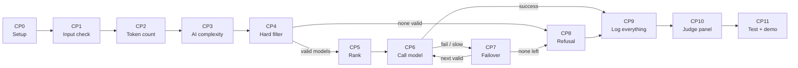

# NeuroRoute — USP and Build Pipeline (6-hour plan)

## Part A — Our USP (what makes us different)

**One line:** *NeuroRoute picks the cheapest AI model that is guaranteed to follow every rule of the request — and it proves it by showing why every other model was rejected.*

### Why this is different (in simple words)
Most routers just say "this model looks best." We say **"this model is *allowed*, and here is proof."**

| # | USP | Simple meaning | Why judges care |
|---|---|---|---|
| 1 | **Rules before AI** | Hard rules (cost, speed, capability, context) are plain code. AI can never break them. | Matches "correctness must follow checkable rules" |
| 2 | **Safe failover** | Backup models come only from the list that already passed all rules. | Problem says failover must *never relax a constraint* |
| 3 | **Every decision is explained** | For each request: who was considered, who was rejected, and the reason. | Problem says "make every decision explainable" |
| 4 | **Honest "No"** | If nothing fits, we say "No valid model" and send nothing. | Problem says refuse clearly, don't use an invalid model |
| 5 | **AI that knows it is unsure** | The classifier gives a confidence. Low confidence means we assume the request is harder (safer). | Problem says treat estimates as uncertain |
| 6 | **Judge can break things live** | A panel to change a model's speed or switch it off, and watch the router adapt. | Problem says judges must be able to do this |
| 7 | **Works fully offline** | Simulated models + local classifier. No paid API. | Hackathon rule: local fallback |

**Pitch line for judges:** *"Other routers optimise. We guarantee."*

---

## Part B — The pipeline, checkpoint by checkpoint

### The big picture


| Checkpoint | Name | Time (6 h total) |
|---|---|---|
| CP0 | Setup and model registry | 0:00 – 0:30 |
| CP1 | Receive and validate the request | 0:30 – 0:50 |
| CP2 | Estimate token size and cost | 0:50 – 1:10 |
| CP4 | Hard filter (built before the AI part) | 1:10 – 2:00 |
| CP5 | Rank valid models | 2:00 – 2:20 |
| CP6 | Call model with timeout (simulated models) | 2:20 – 2:50 |
| CP7 | Failover | 2:50 – 3:20 |
| CP8 | Clear refusal | 3:20 – 3:30 |
| CP3 | AI complexity classifier | 3:30 – 4:20 |
| CP9 | Logging | 4:20 – 4:40 |
| CP10 | Judge control panel | 4:40 – 5:30 |
| CP11 | Tests and demo rehearsal | 5:30 – 6:00 |

> **Why CP3 is built late:** the router must work correctly even with *no AI*. We build the safe rule-based core first, then add the AI as an extra layer. If time runs short, the project still works.

---

### CP0 — Setup and model registry
**What to do:** Create the project and write down the list of models (our fictional catalogue).

**How to do it:**
1. Make folders: `gateway/`, `models/`, `classifier/`, `dashboard/`, `tests/`.
2. Install: `pip install fastapi uvicorn pydantic scikit-learn streamlit httpx pytest`.
3. Create `registry.json` with each model's `name, capability (1-5), context_limit, cost_per_1k_tokens, latency_ms, failure_rate, status`.

**What it does:** Gives every other step one single source of truth about the models. Changing this file (or the panel later) changes the router's behaviour.

**Done when:** Python can load `registry.json` and print all models.

**Goes to next:** CP1 takes a user request and will later be compared against this registry.

---

### CP1 — Receive and validate the request
**What to do:** Create the one door (`POST /route`) that accepts a prompt and its rules.

**How to do it:**
1. In FastAPI, define a Pydantic model with: `prompt`, `max_latency_ms`, `max_cost`, `min_capability`, `required_context` (optional), `preference` (`cheapest` / `fastest` / `highest_quality`).
2. Add checks: numbers must be positive, capability 1–5, preference must be one of the allowed words.

**What it does:** Stops bad input at the door so the rest of the pipeline can trust the data.

**Done when:** A good request returns "accepted"; a request with `max_cost = -5` returns a clear error.

**Goes to next:** The valid request object is passed to CP2.

---

### CP2 — Estimate token size and cost
**What to do:** Work out how long the prompt is, and so how much context and money a call will need.

**How to do it:**
1. `tokens = len(prompt) / 4` (simple and good enough; `tiktoken` is optional).
2. `needed_context = max(required_context, tokens + expected_answer_tokens)`.
3. For each model later: `estimated_cost = (tokens + expected_answer_tokens) / 1000 * cost_per_1k`.

**What it does:** Turns "a long contract" into numbers that the filter can compare.

**Done when:** A long text gives a big token count; a short question gives a small one.

**Goes to next:** CP4 (the hard filter) receives the request, `needed_context`, and token counts.

---

### CP4 — Hard filter (the heart of the project)
**What to do:** Throw out every model that breaks any rule, and record why.

**How to do it:** Write one plain function. For each model, check in this order and stop at the first failure:
```python
def check(model, req, needed_context, est_cost, min_cap):
    if model.status != "up":                 return "model is down"
    if model.context_limit < needed_context: return "context too small"
    if model.capability < min_cap:           return "capability too low"
    if model.latency_ms > req.max_latency_ms:return "too slow"
    if est_cost > req.max_cost:              return "too expensive"
    return None   # valid
```
Return two lists: `valid_models` and `rejected = [(model, reason)]`.

**What it does:** Guarantees that only allowed models can ever be used. No AI here, so it is 100% checkable.

**Done when:** pytest has at least one test per rule, and all pass.

**Goes to next:**
- If `valid_models` is not empty → CP5.
- If it is empty → CP8 (refusal).

---

### CP5 — Rank the valid models
**What to do:** Sort the allowed models by what the user prefers.

**How to do it:**
1. `cheapest` → sort by `est_cost` (low to high).
2. `fastest` → sort by `latency_ms`.
3. `highest_quality` → sort by `capability` (high to low).
4. Tie-break: lower `failure_rate` first.

**What it does:** Produces an ordered "try list". The first is the main choice; the rest are ready backups, **all already valid**.

**Done when:** Changing the preference changes the order, but the list never contains a rejected model.

**Goes to next:** The ordered list goes to CP6.

---

### CP6 — Call the model with a timeout
**What to do:** Send the request to the top model and wait, but never longer than the allowed time.

**How to do it:**
1. Write simulated models: a function that waits `latency_ms`, and fails randomly with `failure_rate` (or always, if the panel marked it "down").
2. Use `asyncio.wait_for(call(), timeout = remaining_budget_ms / 1000)`.
3. Record `status` = success / error / timeout, and the time taken.

**What it does:** Makes "too slow" count as a failure, so slowness is handled the same way as a crash.

**Done when:** A normal model returns an answer; a model with an artificial 5-second delay and a 2-second budget gives `timeout`.

**Goes to next:**
- Success → CP9 (log it, return the answer).
- Error or timeout → CP7.

---

### CP7 — Failover (without relaxing any rule)
**What to do:** After a failure, move to the next backup.

**How to do it:**
1. Mark the failed model as unhealthy in this run.
2. Take the **next model from the same valid list** made in CP5 (never rebuild it with looser rules).
3. Recalculate the **remaining time budget** = `max_latency_ms − time already used`. If the next model's `latency_ms` is more than what's left, skip it with the reason "not enough time left".
4. Go back to CP6 with that model.

**What it does:** Gives automatic recovery while keeping the promise that backups still follow every rule.

**Done when:** Marking the first model "down" results in the second valid model answering, and the trace shows both attempts.

**Goes to next:**
- Another valid model remains → back to CP6.
- None left → CP8.

---

### CP8 — Clear refusal
**What to do:** When no valid model exists, say so clearly.

**How to do it:** Return a response such as:
```json
{ "status": "NO_VALID_MODEL",
  "message": "No model satisfies all constraints. Nothing was sent.",
  "rejected": [{"model": "ultra-4", "reason": "too slow"}, ...] }
```
Optionally add a hint: "Relax `max_latency_ms` to 3500 and `pro-3` becomes valid." (This is advice for the user only, **never applied automatically**.)

**What it does:** Protects correctness: no request is ever sent to an invalid model.

**Done when:** Impossible rules (e.g. 100 ms + capability 5) always give this response.

**Goes to next:** CP9 (log it).

---

### CP3 — AI complexity classifier (the "meaningful AI")
**What to do:** Guess how hard the prompt is (1 = easy … 5 = very hard) and how sure we are.

**How to do it:**
1. Write about 60 fictional prompts (12 per level) in a CSV: `prompt, level`.
2. Train: `TfidfVectorizer` + `LogisticRegression` (scikit-learn). Save it with `joblib`.
3. Predict with `predict_proba`: `level = argmax`, `confidence = max probability`.
4. **Safety rule:** if `confidence < 0.6`, use `level + 1` (assume harder).
5. `min_cap_used = max(req.min_capability, estimated_level)`. The AI can only **raise** the needed capability, never lower the user's own minimum.
6. **Fallback if raising it makes the valid list empty:** use the user's own `min_capability` and mark the trace `low_confidence_routing: true`. Cost and latency limits are never broken.

**What it does:** Helps pick a model that is smart enough even when the user did not state a capability, while treating the guess as uncertain.

**Where it plugs in:** It runs *before* CP4 and only supplies `min_cap_used`. We build it after the safe core works.

**Done when:** "What is 2+2?" gets a low level, "Analyse risks in this 30-page contract" gets a high level, and a vague prompt shows low confidence in the trace.

**Goes to next:** `min_cap_used` is passed into CP4's capability check.

---

### CP9 — Logging everything
**What to do:** Save what happened for every request.

**How to do it:**
1. Create a SQLite table `requests` with: `id, time, prompt_preview, constraints, estimated_level, confidence, chosen_model, status, total_latency, cost, attempts_json, rejected_json`.
2. Insert one row at the end of every request, including refusals.

**What it does:** Lets judges review behaviour later: cost, latency, failures, and decisions.

**Done when:** After 5 requests, `SELECT * FROM requests` shows 5 rows with complete traces.

**Goes to next:** The dashboard in CP10 reads this table.

---

### CP10 — Judge control panel (Streamlit)
**What to do:** Build a simple screen for live testing.

**How to do it:**
1. **Left side:** for each model, a toggle (up/down), a latency slider, a failure-rate slider. These write to `registry.json` (or an in-memory copy).
2. **Centre:** a request form (prompt + 5 rules) and a "Send" button that calls `/route`.
3. **Results:** show the answer, the chosen model, the considered/rejected table with reasons, and the attempts list.
4. **Bottom:** the history table from SQLite plus one chart (cost or latency per request).
5. **Preset buttons:** "Simple question", "Long contract", "Primary down", "Impossible", "Vague prompt".

**What it does:** Lets judges change a model's latency or availability and instantly see a valid alternative selected.

**Done when:** Switching the chosen model off in the panel and re-sending gives a different valid model.

**Goes to next:** CP11 uses this panel for the demo.

---

### CP11 — Tests and demo rehearsal
**What to do:** Prove it works and practise the story.

**How to do it:**
1. Run `pytest` (filter rules, ranking, failover, refusal).
2. Click through the 8 scenarios in the README.
3. Check *same input → same output* (reproducibility). Fix the random seed for failures.
4. Prepare a 2-minute script: problem → USP → live break-a-model demo → impossible request → logs.
5. Take backup screenshots.

**What it does:** Removes surprises on judging day.

**Done when:** The full demo runs twice without a mistake.

---

## Part C — If time runs out (cut in this order)
1. Charts → keep only the log table.
2. `highest_quality` preference → keep `cheapest` and `fastest`.
3. Classifier (CP3) → keep rule-based core; say "AI layer is next step". *(Risky: the hackathon requires meaningful AI, so keep CP3 if at all possible.)*
4. **Never cut:** CP4 (filter), CP7 (safe failover), CP8 (refusal), the decision trace.
