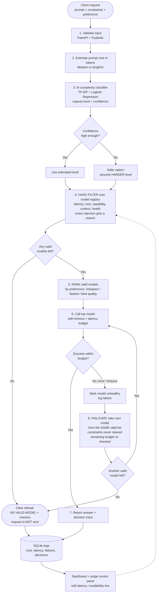

# NeuroRoute — ModelRouter (A-01)
### A smart "traffic police" for AI models: cost-, latency- and quality-aware routing

> VORTEXA 3.0 · Domain 2 — AI Systems & Infrastructure · Problem A-01

---

## 1. The problem in plain words (no AI background needed)

### 1.1 The everyday picture
Think of a hospital with three kinds of doctors:

| Doctor | Fee | Speed | Can handle |
|---|---|---|---|
| Nurse / junior doctor | ₹ | Very fast | Cold, small injuries |
| General physician | ₹₹ | Medium | Most normal illnesses |
| Specialist surgeon | ₹₹₹₹ | Slow | Serious, complex cases |

- If **every** patient sees the surgeon → very expensive and slow.
- If **every** patient sees the nurse → hard cases get bad treatment.
- If the doctor you picked **doesn't show up** → you need a backup, **and the backup must still be right for the patient** (not just "whoever is free").

Now replace "doctors" with **AI models** (like GPT, Claude, Llama, Gemini). Companies use several of them. Each model differs in:

| Property | Meaning | Simple example |
|---|---|---|
| **Cost** | Price per request | Small model: ₹0.01, big model: ₹1 |
| **Latency** | How long it takes to answer | 0.5 s vs 8 s |
| **Capability** | How "smart" it is on hard tasks | Can it analyse a 40-page contract? |
| **Context length** | How much text it can read at once | 8,000 words vs 200,000 words |
| **Reliability** | Does it stay online? | Servers crash or slow down sometimes |

### 1.2 What goes wrong today
1. **Overpaying:** a simple question like *"What is the capital of France?"* is sent to the most expensive model.
2. **Bad quality:** a hard task like *"Find risky clauses in this contract"* is sent to the cheapest model.
3. **Breaking:** the app is hard-wired to one model. If that model is down, the whole feature stops.
4. **Unsafe backup:** in a hurry, the backup model chosen is cheaper but cannot read long documents → silently wrong result.

### 1.3 What we must build
An **AI Gateway** (a "router"): one door that all requests pass through. For each request it:

1. Reads the request's **rules** (constraints).
2. Picks the **best allowed model**.
3. If the model fails or is too slow, **switches to another allowed model**.
4. If nothing is allowed, says **"No valid model"** — it never sends the request to a wrong model.
5. **Explains** every decision and **records** cost, speed and failures.

### 1.4 The rules a request carries (HARD constraints)
"Hard" means **no exceptions**. A model that breaks even one rule is *not a valid choice*.

| Rule | Meaning | Example |
|---|---|---|
| `max_latency_ms` | Answer must come within this time | 2000 ms |
| `max_cost` | Must not cost more than this | ₹0.05 |
| `min_capability` | Model must be at least this smart (e.g. level 1–5) | level 3 |
| `required_context` | Model must be able to read this much text | 50,000 tokens |
| `preference` | Among valid ones, what do we prefer? | "cheapest" |

> **Important idea:** *Rules are not preferences.* First remove every model that breaks a rule. Only then choose among the rest.

### 1.5 Glossary (words you will see)
- **LLM / model:** the AI that reads text and writes answers.
- **Token:** a small piece of text (≈ ¾ of a word). Models charge and limit by tokens.
- **Endpoint:** the web address where a model runs.
- **Failover (fallback):** automatically switching to another model when the first fails.
- **Gateway / router:** the middle layer that decides which model gets the request.
- **Complexity estimate:** our guess of how hard a request is, based on its text.

### 1.6 Five things the judges will check (from the problem statement)
1. ✅ Hard constraints are never broken — not even during failover.
2. ✅ Every decision is **explainable** (who was considered, who was rejected, and why).
3. ✅ Failure/slowness → a **valid** alternative is chosen.
4. ✅ Impossible request → **clear refusal**, not a wrong model.
5. ✅ Complexity guesses are treated as **uncertain**; when unsure → pick the **safer** option.
6. ✅ Logs of cost, latency, failures and decisions; judges can **change a model's latency/availability live** and see the router react.

---

## 2. Hackathon requirements — what we must satisfy

From the *Judging Criteria / Common Rules*:

| Rule | What it means for us |
|---|---|
| Working **live MVP** | A running app judges can click and test. No slides-only / static dashboards. |
| **Reproducible** testing | Same input → same, repeatable behaviour. Include sample requests and a seed. |
| **Meaningful AI** | Not just "an LLM call that rewrites text". Our AI = **request-complexity classifier** that affects routing. |
| **Correctness by explicit rules** | AI may *inform*, but **hard constraints are plain, checkable code** and AI can never override them. |
| **Fictional data only** | Use our own made-up model catalogue and sample prompts. |
| **No paid API / GPU** | Core demo must run **fully local**. External AI is optional. |
| **Local fallback** | Provide simulated and/or local models (e.g. Ollama small model) so the demo never depends on internet. |

---

## 3. Existing solutions (what already exists, and what we borrow)

| Tool | What it does | Strength | Gap vs. this problem | How we use it |
|---|---|---|---|---|
| **LiteLLM** (open source) | One interface to 100+ models; has router with fallbacks, retries, cooldowns, cost tracking, latency-based routing | Very popular, reliable, easy | Does not enforce a *per-request* set of hard constraints with an explainable rejection list | Optional: use as the **call layer** for real models |
| **OpenRouter** | Hosted gateway to many models with price/latency info and fallbacks | Easy | Paid, external, black-box decisions | Reference only (not allowed as core) |
| **RouteLLM** (LMSYS, open source) | Trained routers that decide *strong vs. weak model* to save cost | Proven idea: classifier decides model | Only 2-model, no hard constraints/failover | **Idea borrowed**: classify difficulty → route |
| **Martian / Not Diamond** | Commercial "model routers" that predict the best model | Good quality | Paid, closed | Reference only |
| **Portkey / Helicone / Cloudflare AI Gateway** | Gateways with logging, caching, retries, observability | Great dashboards | Hosted/paid, not constraint-first | **Idea borrowed**: logging + dashboard |
| **Ollama** | Runs small open models locally (e.g. Llama / Qwen / Phi) | Free, offline, simple | Not a router | **Local fallback models** |
| **scikit-learn** | Classic ML (TF-IDF, logistic regression) | Tiny, fast, no GPU, trustworthy | — | **Complexity classifier** |
| **FastAPI** | Python web API framework | Fast to build, auto docs (Swagger) | — | The **gateway server** |
| **Streamlit** (or simple HTML) | Quick dashboards | Built in an hour | — | **Judge control panel** |
| **SQLite** | File-based database | Zero setup | — | **Logs / metrics** |

**Takeaway:** existing tools solve *"call many models"* and *"save cost with a classifier"*, but none gives a **constraint-first, explainable, never-relax-on-failover** decision out of the box. That decision engine is **our core contribution**; everything else we reuse.

---

## 4. Technical approach

### 4.1 Design principle: "Rules first, AI second"
```
HARD RULES (plain code, 100% checkable)   →   decide who is ALLOWED
AI estimate (uncertain, helpful)           →   helps choose among the ALLOWED, never overrides rules
```

### 4.2 Pipeline flowchart



### 4.3 Step-by-step explanation

**Step 1 — Validate the request.** Use FastAPI + Pydantic so wrong inputs (negative cost, missing fields) are rejected immediately.

**Step 2 — Count tokens.** Estimate how long the prompt is. This tells us the *required context* (prompt + expected answer) and the *expected cost* (tokens × price).

**Step 3 — AI complexity classifier (our "meaningful AI").**
- A small text classifier (TF-IDF + Logistic Regression, scikit-learn) trained on ~100–200 **self-written fictional prompts** labelled *simple / medium / hard*.
- Output: a **level** and a **confidence**. Example: `hard (0.62)`.
- **If confidence is low → choose the safer option** = treat as the harder level.
- Optional upgrade: sentence embeddings (`sentence-transformers`, runs on CPU) for better accuracy. Keep TF-IDF as the always-works fallback.
- Add simple signals too: length, words like "analyse / compare / legal clause / prove", code blocks, numbers.

**Step 4 — Hard filter (pure code, no AI).** For each model in the registry, check in order and record the **first failing reason**:

| Check | Reject if… |
|---|---|
| Health | model marked down |
| Context | `required_context > model.context_limit` |
| Capability | `model.capability < max(min_capability, estimated_level)` |
| Latency | `model.latency_ms > max_latency_ms` |
| Cost | `estimated_cost > max_cost` |

> Detail on safety: the AI estimate may only **raise** the needed capability (safer). It never lowers the user's own `min_capability`. If raising it makes the list empty, we fall back to the user's stated minimum and flag the answer as **"low-confidence routing"** — we do not break the user's hard cost/latency limits.

**Step 5 — Rank.** Among valid models, sort by the preference (`cheapest`, `fastest`, `highest_quality`). Ties break by reliability score.

**Step 6 — Call with a timeout.** The timeout equals the latency budget, so "too slow" is treated as a failure.

**Step 7/8 — Failover without relaxing.** On error or timeout, move to the **next model in the already-validated list**. Because the list was built with all constraints, the backup *automatically* respects them. We also re-check the **remaining** time budget so a slow first attempt doesn't make the second attempt illegal. If the list is exhausted → clear refusal.

**Step 9 — Record everything.** Save: request id, chosen model, rejected models + reasons, cost, latency, attempts, failures.

### 4.4 Model registry (fictional, editable)

| Model | Capability (1–5) | Context (tokens) | Cost / 1K tokens | Avg latency | Status |
|---|---|---|---|---|---|
| `nano-1` | 1 | 4,000 | ₹0.01 | 300 ms | up |
| `mini-2` | 2 | 16,000 | ₹0.05 | 700 ms | up |
| `pro-3` | 3 | 64,000 | ₹0.30 | 1,500 ms | up |
| `ultra-4` | 4 | 128,000 | ₹1.00 | 3,000 ms | up |
| `max-5` | 5 | 200,000 | ₹2.50 | 5,500 ms | up |
| `local-llama` (Ollama) | 2 | 8,000 | ₹0 | 1,200 ms | up |

- **Simulated models** (fake endpoints with adjustable delay and failure rate) make the demo **fully reproducible and offline**.
- 1–2 can be **real local models via Ollama**, so the gateway also does real inference.

### 4.5 Example decision trace (what judges will see)

```json
{
  "request_id": "r-1042",
  "constraints": {"max_latency_ms": 2000, "max_cost": 0.10, "min_capability": 3, "required_context": 20000},
  "complexity_estimate": {"level": 3, "confidence": 0.58, "action": "low confidence -> kept safer level 3"},
  "considered": [
    {"model": "nano-1",  "valid": false, "reason": "capability 1 < 3"},
    {"model": "mini-2",  "valid": false, "reason": "capability 2 < 3"},
    {"model": "pro-3",   "valid": true,  "est_cost": 0.06, "latency_ms": 1500},
    {"model": "ultra-4", "valid": false, "reason": "latency 3000 > 2000"},
    {"model": "max-5",   "valid": false, "reason": "latency 5500 > 2000"}
  ],
  "chosen": "pro-3",
  "attempts": [{"model": "pro-3", "status": "timeout"}],
  "result": "NO VALID MODEL left after failover (all other models violate constraints)"
}
```

### 4.6 Judge control panel (for live testing)
- Sliders/inputs to **change each model's latency**, **toggle it up/down**, and set a **failure rate**.
- A request form: prompt + the 5 constraints.
- Buttons for **preset scenarios**: "Simple question", "Long contract", "Primary model down", "Impossible constraints", "Ambiguous prompt".
- Live view: decision trace, cost/latency charts, failure counter, request history table.

### 4.7 Suggested tech stack (all free, all offline-capable)

| Layer | Tool |
|---|---|
| API / gateway | Python + **FastAPI** |
| Data validation | **Pydantic** |
| AI classifier | **scikit-learn** (TF-IDF + Logistic Regression); optional **sentence-transformers** |
| Token counting | **tiktoken** or `len(text)/4` |
| Model calls | **httpx** (async, timeouts); optional **LiteLLM** for real providers |
| Local real model | **Ollama** (small model) |
| Storage | **SQLite** |
| UI | **Streamlit** (fastest) or plain HTML + JS |
| Tests | **pytest** for constraint and failover rules |

---

## 5. Test scenarios (also our demo script)

| # | Scenario | Expected result |
|---|---|---|
| 1 | Short factual question, cheap preference | Cheapest valid model chosen |
| 2 | Long contract, large context needed | Only large-context models considered; small ones rejected with reasons |
| 3 | Judge sets chosen model to **down** | Next valid model chosen automatically |
| 4 | Judge raises chosen model's **latency** above budget | Model rejected / timed out → valid alternative |
| 5 | Failover candidate would break the cost limit | Skipped; never used |
| 6 | Impossible constraints (e.g. 100 ms + level 5) | Clear **"No valid model"** with reasons; nothing sent |
| 7 | Vague prompt, low classifier confidence | Safer (higher) level assumed, flagged in trace |
| 8 | Same request run twice | Same decision (reproducible) |

---

## 6. 6-hour build plan (our real time limit)

**Rule of the day:** build the core first, make it demo-able by hour 4, polish after.

| Hour | Work | Done when |
|---|---|---|
| 0:00–0:30 | Fix the model registry (JSON file), request format, folder structure. Split work among teammates. | Everyone knows their part |
| 0:30–2:00 | **Core engine:** hard filter + ranking + decision trace (plain Python, with a few pytest tests) | Given constraints, correct valid/rejected list with reasons |
| 2:00–3:00 | **Simulated models + failover:** fake endpoints with adjustable delay / on-off; timeout; failover from the validated list | Switching a model off picks a valid alternative |
| 3:00–4:00 | **Complexity classifier:** ~60 hand-written prompts, TF-IDF + Logistic Regression, confidence, "low confidence -> safer level" rule | Classifier changes routing; ambiguous prompt is flagged |
| 4:00–5:00 | **Streamlit panel:** request form, latency/availability controls, decision trace, SQLite log table, simple cost/latency chart | Judges can test everything live |
| 5:00–5:30 | 5 preset scenarios (simple, long contract, model down, impossible, ambiguous) + edge-case checks | Scenarios 1-7 in Section 5 pass |
| 5:30–6:00 | README polish, demo rehearsal, backup screenshots | Demo runs end to end twice |

### What we cut or postpone (only add if time is left)
| Feature | 6-hour decision |
|---|---|
| Ollama real local model | **Optional**, only after hour 5 |
| LiteLLM / real providers | **Skip** (simulated models already satisfy "no paid API") |
| sentence-transformers embeddings | **Skip** (TF-IDF is enough) |
| Fancy dashboard / charts | One simple chart + a log table |
| Multiple preference types | Build `cheapest` and `fastest` first; add `highest_quality` last |

### Suggested split for a team of 2-4
| Person | Owns |
|---|---|
| A | Core engine: filter, ranking, trace, tests |
| B | Simulated models, timeouts, failover |
| C | Classifier and its small dataset |
| D | Streamlit panel, logging, README, demo script |

(With two people: A+B and C+D.)

---

## 7. Judging-criteria mapping

| Judge requirement | Where we satisfy it |
|---|---|
| Working live MVP | FastAPI + Streamlit app, runs locally |
| Meaningful AI | Complexity classifier changes routing; handled with confidence |
| Correctness by explicit rules | Hard filter is plain code + pytest; AI cannot override |
| No paid API / local fallback | Simulated models + Ollama; no internet needed |
| Fictional data | Self-written catalogue and prompts |
| Explainability | Per-request trace: considered / rejected / reason |
| Failover without relaxing constraints | Fallbacks come only from the pre-validated list |
| Clear failure when impossible | "No valid model" response with reasons |
| Observability | SQLite logs + dashboard of cost, latency, failures |
| Live tweaking by judges | Control panel for latency and availability |

---

## 8. Risks and how we handle them

| Risk | Handling |
|---|---|
| Classifier is wrong | Treat as uncertain; low confidence → safer level; hard rules still protect |
| Failover wastes time budget | Re-check remaining latency before each attempt |
| Internet or Ollama fails at demo | Simulated models always work offline |
| Too much scope | Core (filter + failover + trace) first; UI and extras after |

---

## 9. Quick start
```bash
pip install -r requirements.txt
python -m uvicorn src.gateway.main:app --reload  # start gateway & unified dashboard at http://localhost:8000
python -m pytest                                 # run test suite
```

---

## 10. Workspaces and model slots

NeuroRoute features isolated, cookie-based guest workspaces allowing every user to configure up to **six model slots**.

### Core Architecture & Invariants
1. **The Six-Model Limit**:
   - Each workspace possesses exactly 6 slots (slots 1 through 6).
   - Enforced directly by database schema constraints (`CHECK(slot_number BETWEEN 1 AND 6)` and `UNIQUE(workspace_id, slot_number)`). A 7th slot cannot be created.
   - An **empty slot = no row** in the database; the API dynamically fills gaps to always provide 6 slot objects.
2. **Guest Sessions**:
   - Guest workspaces are provisioned automatically via a high-entropy `nr_session` cookie (`secrets.token_urlsafe(32)`).
   - Only the SHA-256 hash of the token is saved in the database; raw tokens are never logged or stored.
   - Sessions are browser-scoped and do not synchronize across devices or survive incognito resets.
3. **Model Manager & Operations**:
   - Add models to empty slots (`POST /api/workspace/models/{slot}`).
   - Fully edit/replace models in occupied slots (`PUT /api/workspace/models/{slot}`).
   - Adjust latency, failure rates, and status (`PATCH /api/workspace/models/{slot}`).
   - Toggle routing availability (`PATCH /api/workspace/models/{slot}/toggle`).
   - Run offline simulated latency & health trials (`POST /api/workspace/models/{slot}/test`).
   - Remove models (`DELETE /api/workspace/models/{slot}`).
4. **Serverless & Database Considerations**:
   - SQLite with file persistence in `/tmp` on serverless platforms (e.g. Vercel Lambdas) is ephemeral across cold starts and not shared across concurrent instances. For production serverless deployments, an external managed database (such as Supabase PostgreSQL) is recommended.

---

## 11. Bring Your Own Key (BYOK) & Live Providers

NeuroRoute supports live completions with real LLM providers using BYOK (Bring Your Own Key).

### Supported Providers Allowlist
For SSRF safety, NeuroRoute enforces a strict provider allowlist with hardcoded API endpoints:
- **OpenAI** (`openai`): `https://api.openai.com/v1`
- **Groq** (`groq`): `https://api.groq.com/openai/v1`
- **DeepSeek** (`deepseek`): `https://api.deepseek.com/v1`
- **OpenRouter** (`openrouter`): `https://openrouter.ai/api/v1`
- **Anthropic** (`anthropic`): `https://api.anthropic.com/v1`
- **Ollama** (`ollama`): `http://localhost:11434/v1` (No API key required)

Custom endpoint URLs are disallowed to eliminate Server-Side Request Forgery (SSRF) risks against private networks and cloud metadata services.

### Generating & Setting the Secret Key
API keys are encrypted symmetrically at rest using Fernet encryption (`cryptography`). If `NEUROROUTE_SECRET_KEY` is not set when configuring a live model slot with an API key, the API returns HTTP 503 `SECRET_KEY_MISSING` with message `"Live mode needs NEUROROUTE_SECRET_KEY. See README."`.

Generate a 32-byte URL-safe base64 key:
```bash
python -c "from cryptography.fernet import Fernet; print(Fernet.generate_key().decode())"
```

Configure the environment variable before starting the server:
```bash
# Linux / macOS
export NEUROROUTE_SECRET_KEY="your-generated-fernet-key"

# Windows PowerShell
$env:NEUROROUTE_SECRET_KEY="your-generated-fernet-key"
```

### Safety Limits & Live Call Guards
1. **Prompt Length Limit**: Prompts sent to `/route` cannot exceed **8,000 characters**. Requests violating this limit are rejected with HTTP 400 `PROMPT_TOO_LONG`.
2. **Rate Limiting**: To prevent accidental credit drain or runaway loops, live provider invocations are rate-limited to **20 calls per minute** per workspace. Exceeding this returns HTTP 429 `RATE_LIMIT_EXCEEDED`.
3. **Usage & Cost Tracking**: Completed requests record exact token usage and latency in `trace["usage"]`, consisting strictly of `{"input_tokens", "output_tokens", "actual_cost", "latency_ms"}`. `actual_cost` is calculated in INR (₹) using `cost_per_1k_input`/`output` (or `cost_per_1k`).
4. **Key Redaction**: API keys never appear in plaintext in logs, database dumps, HTTP responses, or traces. Only the last 4 digits (`key_last4`) and boolean `has_key` are exposed.

### Adding a live model from the dashboard
1. Ensure the gateway server was started with `NEUROROUTE_SECRET_KEY` set in your environment.
2. In the **Model Manager** section on the dashboard (`http://localhost:8000`), click **+ Add Model** on any empty slot (or **Edit** on an existing slot).
3. Set **Execution Mode** to **Live**.
4. Select a supported provider from the dropdown (e.g. `openai`, `groq`, `deepseek`, `anthropic`, `openrouter`, or local `ollama`).
5. Enter your provider's API key into the write-only password field (not required for local `ollama`).
6. Specify your model's parameters: Model ID (e.g. `gpt-4o-mini`), capability tier (1–5), context limit, input/output token pricing, and expected latency.
7. Click **Save Model**. The key is encrypted immediately on the server; the dashboard card will display a `LIVE` badge and `key ····LAST4`.
8. Click **Test (real call)** on the slot card to run an instant 1-token health ping to verify live connectivity.

> [!WARNING]
> **Data Privacy Notice**: When live execution mode is selected, your prompt and context are transmitted directly to the third-party model provider you selected (e.g. OpenAI, Anthropic, Groq). Do not submit confidential data or credentials in prompts.

> [!IMPORTANT]
> **Key Lifecycle & Security Scope**:
> - Keys are encrypted at rest, but NeuroRoute guest workspaces are session-isolated workspaces, **not** an enterprise multi-tenant identity/authentication system.
> - **Do NOT deploy live API keys to ephemeral serverless environments (e.g. Vercel / AWS Lambda with `/tmp` SQLite)**. Ephemeral storage resets between cold starts and instances. Deploy live BYOK only with persistent shared storage (e.g. managed PostgreSQL) and a dedicated secrets manager (e.g., AWS Secrets Manager, HashiCorp Vault).
> - If `NEUROROUTE_SECRET_KEY` is rotated or lost, previously encrypted keys cannot be recovered or decrypted and must be re-entered.

---

## 12. Dual-Backend Architecture (SQLite & PostgreSQL)

NeuroRoute implements a zero-ORM dual-backend database abstraction in [`src/gateway/db.py`](file:///d:/neuroRoute/NeuroRoute/src/gateway/db.py) supporting both local SQLite storage and high-concurrency PostgreSQL.

### Deterministic Backend Selection Precedence
1. **Production & Serverless Safety Check**:
   - The application checks [`is_production_environment()`](file:///d:/neuroRoute/NeuroRoute/src/gateway/db.py) (triggered if `ENVIRONMENT`, `ENV`, `NODE_ENV` is set to `'production'` or `VERCEL` is present).
   - If in a production environment and `DATABASE_URL` is missing or empty, application startup **fails immediately** with `DatabaseConfigError`. Ephemeral SQLite storage is strictly prohibited in production.
2. **Explicit Database Selection**:
   - If `DATABASE_URL` is set: selects **PostgreSQL** via Psycopg 3 connection pooling.
   - If PostgreSQL connection fails: raises `DatabaseConnectionError`. The application **never silently falls back to SQLite**.
   - If `DATABASE_URL` is unset or empty: selects **SQLite**. Connects to `NEUROROUTE_DB` if defined, or falls back to local `neuroroute.db`.

### Connection Pooling Configuration & Health Checking
When PostgreSQL is active, connections are managed through `psycopg_pool.ConnectionPool` with `row_factory=dict_row`, active health check validation, and configurable bounds:
- `DB_POOL_MIN_SIZE`: Minimum idle connections maintained in the pool (default: `1`).
- `DB_POOL_MAX_SIZE`: Maximum active connections allocated to the pool (default: `10`).
- `DB_POOL_TIMEOUT`: Connection acquisition timeout in seconds (default: `10.0`).
- `DB_POOL_MAX_IDLE`: Maximum duration in seconds a connection may remain idle before eviction (default: `300.0`).
- `DB_POOL_MAX_LIFETIME`: Maximum total lifespan in seconds before a connection is recycled (default: `3600.0`).
- **Active Health Checking**: The pool utilizes `check=psycopg_pool.ConnectionPool.check_connection` on connection checkout. Severed or expired connections (e.g., terminated by firewalls, load balancers, or server idle timeouts) are automatically discarded and refreshed transparently without raising errors to the caller.

### Schema Readiness & Separation of Migrations
- **SQLite Mode**: On server boot, `init_db()` and `init_workspace_schema()` create local tables and indexes if they do not already exist.
- **PostgreSQL Mode**: Handled inside the FastAPI `lifespan` context manager via [`check_postgres_schema_readiness()`](file:///d:/neuroRoute/NeuroRoute/src/gateway/migrator.py). Performs purely read-only schema verification without requiring DDL privileges (`CREATE/ALTER/DROP`). Aborts safely with `SchemaNotReadyError` if schema is missing or unapplied migrations exist, never falling back to SQLite.
- **Out-of-Band Migration Runner**: Schema migrations are executed out-of-band using the standalone migration CLI:
  ```bash
  # Check migration readiness (read-only)
  python -m src.gateway.migrator --check

  # Apply pending migrations transactionally with advisory locking
  python -m src.gateway.migrator
  ```
- **Optional Auto-Migration**: For local development and continuous integration, set `AUTO_MIGRATE=1` to allow automatic migration application during application startup.
- **Least-Privilege Roles**: NeuroRoute defines three isolated database roles ([`scripts/setup_postgres_roles.sql`](file:///d:/neuroRoute/NeuroRoute/scripts/setup_postgres_roles.sql)):
  1. `neuroroute_admin`: Handles schema and data migrations, sequence ownership, and initial SQLite-to-PostgreSQL imports.
  2. `neuroroute_app`: Performs normal gateway operations with zero DDL privileges (cannot `DELETE` from `workspaces` or `UPDATE`/`DELETE` `requests`).
  3. `neuroroute_cleanup`: Performs authorized maintenance purges via [`scripts/cleanup_expired_workspaces.py`](file:///d:/neuroRoute/NeuroRoute/scripts/cleanup_expired_workspaces.py) and unlinks `requests.workspace_id` as required (with zero insert or sequence access).

---

## 13. SQLite-to-PostgreSQL Data Migration Utility

The standalone CLI utility [`scripts/migrate_sqlite_to_postgres.py`](file:///d:/neuroRoute/NeuroRoute/scripts/migrate_sqlite_to_postgres.py) transfers data from SQLite (`neuroroute.db`) to PostgreSQL without downtime or data loss.

### Supported CLI Arguments
| Argument | Default | Purpose |
| :--- | :--- | :--- |
| `--source-db PATH` | `neuroroute.db` | Path to source SQLite database file. Read-only. |
| `--target-url URL` | `$DATABASE_URL` | Destination PostgreSQL connection URL. |
| `--init-schema` | `False` | Automatically applies PostgreSQL DDL migrations (`migrations/postgres/`) before importing data if tables are missing. |
| `--dry-run` | `False` | **Preflight validation only**. Inspects source row counts and schema, checks target connectivity and table emptiness, but **writes zero data**. |
| `--verify-only` | `False` | **Parity audit only**. Connects to SQLite and PostgreSQL and verifies 100% equivalence of row counts, primary keys, foreign keys, timestamps, and model slot configurations without modifying either database. |
| `--allow-non-empty` | `False` | Override flag to permit importing into non-empty tables (fails closed by default with `TargetNotEmptyError`). |

### Migration Guarantees & Safety Architecture
1. **Source Immutability**: The source SQLite file is opened exclusively in read-only mode (`sqlite3.connect('file:...?...&mode=ro', uri=True)`); it is never modified.
2. **Topological Order**: Tables are imported strictly in foreign-key dependency order:
   `workspaces` ➔ `model_slots` ➔ `model_test_runs` ➔ `requests`.
3. **Surrogate Key Preservation**: Rows are inserted with `OVERRIDING SYSTEM VALUE`, preserving exact SQLite primary keys across all four tables.
4. **Sequence Synchronization**: After insertion, PostgreSQL identity sequences are updated (`setval`) to `MAX(id) + 1` so subsequent application writes never trigger key collisions.
5. **BYOK Ciphertext Security**: Encrypted API keys in `model_slots.api_key_encrypted` are transferred strictly as opaque ciphertext strings. The migration tool never decrypts, transforms, or logs credentials.
6. **Atomic Rollback**: The entire migration and sequence update runs in a single transaction; any failure automatically rolls back all changes.

---

## 14. Operational Modalities

NeuroRoute clearly distinguishes three operational environments:

### A. Local Development (Default)
- **Database**: Local SQLite (`neuroroute.db`).
- **Setup**: Zero external database dependencies; fully offline.
- **Command**:
  ```bash
  python -m uvicorn src.gateway.main:app --reload
  ```

### B. PostgreSQL-Backed Local Testing
- **Database**: Dedicated local/containerized PostgreSQL database (e.g. `127.0.0.1:5432/neuroroute_test`).
- **Prerequisites**: PostgreSQL 15+ / 17 running locally.
- **Preflight Check**:
  ```bash
  python scripts/migrate_sqlite_to_postgres.py --target-url "postgresql://postgres@localhost:5432/neuroroute_test" --init-schema --dry-run
  ```
- **Execute Migration**:
  ```bash
  python scripts/migrate_sqlite_to_postgres.py --target-url "postgresql://postgres@localhost:5432/neuroroute_test" --init-schema
  ```
- **Verify Parity**:
  ```bash
  python scripts/migrate_sqlite_to_postgres.py --target-url "postgresql://postgres@localhost:5432/neuroroute_test" --verify-only
  ```
- **Start Gateway with PostgreSQL**:
  ```bash
  export DATABASE_URL="postgresql://postgres@localhost:5432/neuroroute_test"
  python -m uvicorn src.gateway.main:app --reload
  ```

### C. Future Production Deployment (Blueprint)
- **Target**: Managed PostgreSQL instance (Supabase, Neon, AWS RDS, GCP Cloud SQL) with mandatory TLS (`sslmode=require`).
- **Connection Mode**: Connect through a transaction pooler (e.g. Supabase PgBouncer port 6543 or AWS RDS Proxy) for serverless runtimes.
- **Database Role Separation**:
  - **Restricted Runtime Role (`neuroroute_app`)**: The gateway server connects strictly as `neuroroute_app`. Performs normal gateway operations (`SELECT, INSERT, UPDATE` on `workspaces`; `SELECT, INSERT, UPDATE, DELETE` on `model_slots`; `SELECT, INSERT` on `model_test_runs` and `requests`; `SELECT` on `schema_migrations`; `USAGE, SELECT` on identity sequences). Cannot `DELETE` from `workspaces` and cannot `UPDATE` or `DELETE` `requests`. Strictly denied DDL permissions (`CREATE`, `ALTER`, `DROP`, `TRUNCATE`). See [`docs/architecture.md`](file:///d:/neuroRoute/NeuroRoute/docs/architecture.md) §2.1 and §6.
  - **Authorized Maintenance Role (`neuroroute_cleanup`)**: Used exclusively by [`scripts/cleanup_expired_workspaces.py`](file:///d:/neuroRoute/NeuroRoute/scripts/cleanup_expired_workspaces.py) via `CLEANUP_DATABASE_URL`. Performs authorized expired-workspace cleanup (`SELECT, UPDATE, DELETE` on `workspaces`; `SELECT, DELETE` on `model_slots` and `model_test_runs`) and unlinks `requests.workspace_id` (`SELECT, UPDATE (workspace_id)` on `requests`) as required. Strictly denied `INSERT` on all tables, sequence access, and DDL permissions.
  - **Privileged Migration Role (`neuroroute_admin`)**: Handles schema and data migrations (`migrations/postgres/*.sql`, `python -m src.gateway.migrator`, and `scripts/migrate_sqlite_to_postgres.py`). Requires schema ownership / admin privileges for `OVERRIDING SYSTEM VALUE`, `setval`, and DDL. Migrations must never be executed under the restricted runtime role.
- **Mandatory Production Secret**: In production (`ENVIRONMENT=production` or `VERCEL=1`), the server performs fail-fast startup validation for `NEUROROUTE_SECRET_KEY`. If missing or malformed, startup immediately aborts with `SecretConfigError`. Production key must match the key used during SQLite encryption to preserve decryptability of existing BYOK credentials.
- **Rollback Strategy**: Decoupled two-tier rollback:
  - *Tier 1 (Traffic Rollback)*: Revert application deployment or unset `DATABASE_URL` to immediately fall back to the standby backend (< 2 minutes).
  - *Tier 2 (Data Disaster Recovery)*: Restore from pre-cutover Point-In-Time-Recovery (PITR) snapshot (< 15 minutes).

---

## 15. Environment Variables Reference

| Variable | Backend | Default | Description |
| :--- | :--- | :--- | :--- |
| `DATABASE_URL` | PostgreSQL | `None` (SQLite mode) | Connection string (e.g. `postgresql://user:pw@host:5432/db?sslmode=require`). Activates PostgreSQL mode when set. Mandatory in production. |
| `AUTO_MIGRATE` | PostgreSQL | `0` (or `None`) | Set to `1` or `true` to automatically apply pending PostgreSQL migrations during gateway startup. Defaults to read-only readiness check. |
| `MIGRATION_DATABASE_URL` | Migrator | `None` | Optional dedicated admin connection string with DDL privileges for out-of-band schema migrations (`python -m src.gateway.migrator`). |
| `CLEANUP_DATABASE_URL` | Cleanup | `None` | Optional dedicated maintenance connection string for running workspace cleanup (`scripts/cleanup_expired_workspaces.py`). |
| `NEUROROUTE_DB` | SQLite | `neuroroute.db` | Path to SQLite database file. Defaults to `/tmp/neuroroute.db` when `VERCEL` is set. |
| `ENVIRONMENT` | Gateway | `None` | Set to `'production'` in production deployments to enforce mandatory `DATABASE_URL` and `NEUROROUTE_SECRET_KEY`. |
| `NEUROROUTE_SECRET_KEY` | BYOK | `None` | 32-byte URL-safe base64 Fernet key. Mandatory in production; required for live model BYOK encryption and decryption. |
| `DB_POOL_MIN_SIZE` | PostgreSQL | `1` | Minimum idle connections in the Psycopg 3 connection pool. |
| `DB_POOL_MAX_SIZE` | PostgreSQL | `10` | Maximum active connections in the Psycopg 3 connection pool. |
| `DB_POOL_TIMEOUT` | PostgreSQL | `10.0` | Timeout in seconds when waiting for a free connection from the pool. |
| `DB_POOL_MAX_IDLE` | PostgreSQL | `300.0` | Maximum duration in seconds an idle connection remains in the pool before eviction. |
| `DB_POOL_MAX_LIFETIME` | PostgreSQL | `3600.0` | Maximum total lifespan in seconds of a connection before recycling. |
| `NEUROROUTE_SEED` | Router | `None` | Integer seed for deterministic tie-breaking in simulated test models. |
| `TRUST_PROXY_HEADERS` | Gateway | `None` | Optional. Set to `1` or `true` when operating behind a trusted reverse proxy that forwards client-facing `X-Forwarded-Host`. |

---

## 16. Testing and Quality Assurance

The automated test suite provides comprehensive coverage across core routing, slot management, sliding expiration, CSRF defense-in-depth, and dual-backend database operations:

```bash
# Run the complete test suite (201 tests)
python -m pytest

# Run non-browser unit and integration suite (191 tests)
python -m pytest --ignore=tests/browser -q

# Run browser E2E Playwright suite (10 tests)
python -m pytest tests/browser/ -v -rs

# Run CSRF defense-in-depth and body-less mutation tests
python -m pytest tests/test_csrf_bodyless.py -v

# Run workspace sliding expiration tests
python -m pytest tests/test_sliding_expiration.py -v

# Run BYOK encryption, secrets, and provider tests
python -m pytest tests/test_byok.py tests/test_byok_fix.py tests/test_providers.py

# Run workspace isolation and routing tests
python -m pytest tests/test_slots.py tests/test_workspace_routing.py
```

---

## 17. Security and Operational Limitations

1. **Master Secret Persistence**:
   - Provider API keys stored in `model_slots.api_key_encrypted` are encrypted with Fernet symmetric cryptography.
   - If `NEUROROUTE_SECRET_KEY` is rotated or lost, previously encrypted credentials cannot be decrypted (`InvalidToken`) and must be re-entered by the user.
2. **Process-Local Rate Limiting**:
   - The 20 live calls/minute rate limiter is maintained in memory per worker process. In multi-pod or serverless autoscaling environments, rate limiting should be backed by a shared Redis instance to enforce cluster-wide quotas.
3. **Guest Session Scope & Sliding Expiration**:
   - Workspaces use high-entropy browser cookies (`nr_session`). They provide isolated sandboxes for live testing without passwords or logins, but do not synchronize across different browsers or survive private browsing resets.
   - Active workspaces slide their expiration by 30 days upon legitimate request activity (throttled to once per hour, with an emergency slide when remaining lifetime is within 24 hours).
4. **CSRF Defense-in-Depth & Reverse Proxy Safety**:
   - State-changing mutations enforce multi-layer verification: Fetch Metadata (`Sec-Fetch-Site: cross-site` rejected), Origin validation with Referer fallback, body-less authenticated mutation protection, and `Content-Type: application/json` enforcement.
   - Forwarded headers (`X-Forwarded-Host`) are not trusted by default to prevent spoofing attacks. Enable `TRUST_PROXY_HEADERS=1` only when the application is placed behind a verified reverse proxy.
