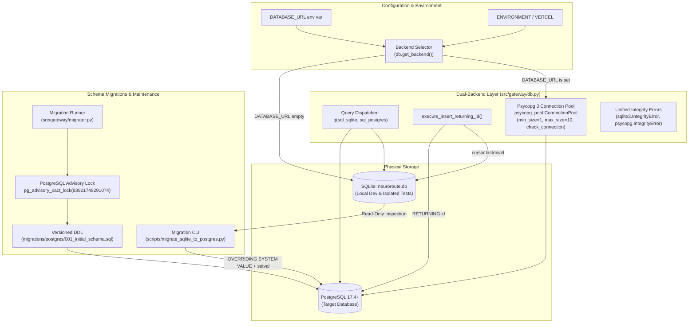
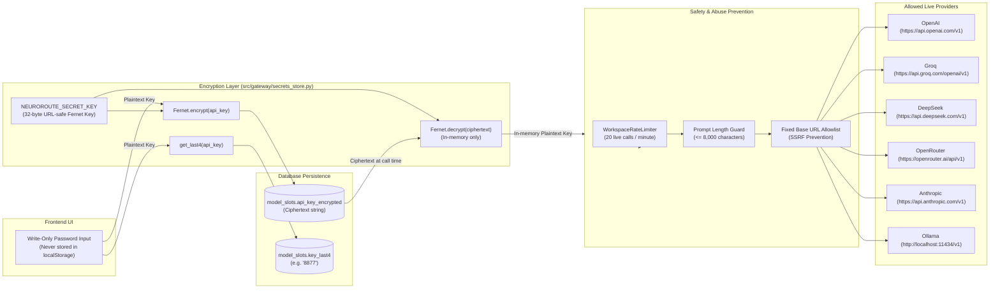
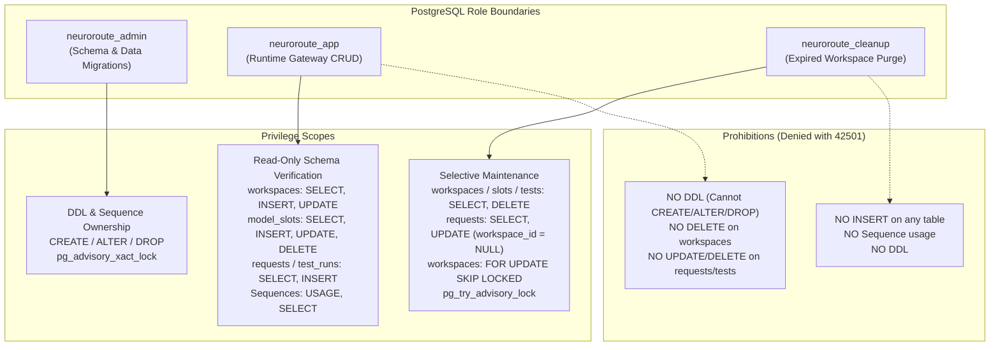

# NeuroRoute System Architecture

NeuroRoute is an inference gateway designed around the principle of **"Rules before AI — Guarantee, don't just optimize."** For every request, the gateway validates hard constraints in deterministic code before selecting candidates, executing safe failover within the remaining time budget, and returning an explainable decision trace.

---

## 1. End-to-End Request and Routing Flow

```mermaid
flowchart TD
    subgraph Client["Client Tier"]
        Browser["Web Browser / Client<br/>(src/dashboard/index.html)"]
    end

    subgraph Gateway["Gateway & Ingestion (FastAPI)"]
        Main["FastAPI Entrypoint<br/>(src/gateway/main.py)"]
        CSRF["CSRF & Validation Guard<br/>Origin/Host + Content-Type check"]
        Session["Guest Session Resolver<br/>(src/gateway/session.py)"]
        CookieCheck{"nr_session cookie<br/>present & valid?"}
        HashToken["Compute SHA-256 Hash<br/>(hash_token)"]
        NewSession["Generate 32-byte Token<br/>Issue HttpOnly Cookie"]
    end

    subgraph WorkspaceLayer["Workspace State & Fleet Resolution"]
        Repo["Workspace Repository<br/>(src/gateway/workspace_repo.py)"]
        FleetLookup["Load Active Workspace Slots<br/>(model_slots: max 6 slots)"]
        LegacyBridge["Legacy Bridge (No Cookie)<br/>(src/models/registry.json)"]
    end

    subgraph Pipeline["Routing Pipeline (src/gateway/router.py)"]
        Tokens["Token Estimator<br/>(src/gateway/tokens.py)"]
        Classifier["Complexity Classifier<br/>(src/classifier/predict.py)"]
        Filter["HARD FILTER<br/>(src/gateway/filter.py)"]
        FilterCheck{"Any candidate<br/>passed all rules?"}
        Refusal["Clear Refusal: NO_VALID_MODEL<br/>(Explain Rejection Reasons)"]
        Ranking["Rank Valid Candidates<br/>(cheapest / fastest / quality)<br/>(src/gateway/ranking.py)"]
        Failover["Cascading Failover Engine<br/>Budget = max_latency - elapsed<br/>(src/gateway/failover.py)"]
    end

    subgraph Execution["Model Execution Tier"]
        Caller["Workspace Caller<br/>(src/gateway/live_call.py)"]
        Simulated["Simulated Models<br/>(src/models/simulated.py)"]
        LiveRouter["Live Provider Dispatcher<br/>(src/providers/registry.py)"]
        OpenAICompat["OpenAI-Compatible Adapter<br/>OpenAI, Groq, DeepSeek,<br/>OpenRouter, Ollama"]
        Anthropic["Anthropic Adapter<br/>Messages API"]
    end

    subgraph Observability["Observability & Storage"]
        Trace["Decision Trace Compiler<br/>(considered, attempts, usage, INR cost)"]
        Logger["Request Logger<br/>(src/gateway/logger.py)"]
        DBAbstract["Database Abstraction Layer<br/>(src/gateway/db.py)"]
        SQLite[(SQLite Database<br/>neuroroute.db)]
        Postgres[(PostgreSQL Database<br/>Psycopg 3 Connection Pool)]
    end

    %% Flow connections
    Browser -->|HTTP Request / Cookies| Main
    Main --> CSRF
    CSRF --> Session
    Session --> CookieCheck
    CookieCheck -->|Yes| HashToken
    CookieCheck -->|No / Expired| NewSession
    HashToken --> Repo
    NewSession --> Repo
    Repo --> FleetLookup

    Main -->|POST /route with Workspace ID| Tokens
    FleetLookup -->|6-Slot Workspace Fleet| Filter
    LegacyBridge -.->|If No Cookie| Filter

    Tokens --> Classifier
    Classifier -->|min_cap = max(user, est)| Filter
    Filter --> FilterCheck
    FilterCheck -->|No| Refusal
    FilterCheck -->|Yes| Ranking
    Ranking --> Failover

    Failover --> Caller
    Caller -->|execution_mode: simulated| Simulated
    Caller -->|execution_mode: live| LiveRouter
    LiveRouter --> OpenAICompat
    LiveRouter --> Anthropic

    Simulated -->|Result / Delay| Failover
    OpenAICompat -->|Token Usage / Response| Failover
    Anthropic -->|Token Usage / Response| Failover

    Failover -->|All Failed / Budget Exceeded| Refusal
    Failover -->|Success| Trace
    Refusal --> Trace
    Trace --> Logger
    Logger --> DBAbstract
    DBAbstract -->|get_backend() == 'sqlite'| SQLite
    DBAbstract -->|get_backend() == 'postgres'| Postgres
    Logger -->|JSON Response + nr_session| Browser
```

---

## 2. Dual-Backend Database Architecture

NeuroRoute features a zero-ORM dual-backend database abstraction defined in [`src/gateway/db.py`](file:///d:/neuroRoute/NeuroRoute/src/gateway/db.py), allowing local development on SQLite and high-concurrency operation on PostgreSQL.



### 2.1 Production Database Role Separation (Least Privilege Architecture)

To satisfy the least-privilege principle and prevent catastrophic database tampering in production, database access is strictly divided into three decoupled roles (see §6 for the comprehensive matrix):

```mermaid
flowchart TD
    subgraph MigrationRole["Privileged Migration Role (neuroroute_admin)"]
        MigrateCLI["scripts/migrate_sqlite_to_postgres.py<br/>(One-time migration)"]
        DDLRunner["src/gateway/migrator.py<br/>(Schema initialization)"]
        AdminPerms["Privileges Required:<br/>- CREATE on schema public<br/>- DDL: CREATE/ALTER/DROP TABLE, INDEX<br/>- Advisory Lock: pg_advisory_xact_lock<br/>- Data Migration: OVERRIDING SYSTEM VALUE<br/>- Sequence Sync: setval() on identities"]
    end

    subgraph RuntimeRole["Restricted Runtime Role (neuroroute_app)"]
        Gateway["Uvicorn / FastAPI Gateway<br/>(src/gateway/main.py)"]
        Pool["Psycopg 3 Connection Pool<br/>(src/gateway/db.py)"]
        RuntimePerms["Privileges Required:<br/>- CONNECT on database<br/>- USAGE on schema public<br/>- DML on application tables:<br/>  * workspaces: SELECT, INSERT, UPDATE (NO DELETE)<br/>  * model_slots: SELECT, INSERT, UPDATE, DELETE<br/>  * model_test_runs: SELECT, INSERT<br/>  * requests: SELECT, INSERT<br/>  * schema_migrations: SELECT<br/>- USAGE, SELECT on identity sequences<br/><br/>Strictly Prohibited:<br/>- DDL (CREATE, ALTER, DROP, TRUNCATE)<br/>- DELETE on workspaces<br/>- UPDATE/DELETE on requests or model_test_runs<br/>- Database / Role Administration"]
    end

    subgraph CleanupRole["Authorized Maintenance Role (neuroroute_cleanup)"]
        CleanupCLI["scripts/cleanup_expired_workspaces.py<br/>(Scheduled maintenance)"]
        CleanupPerms["Privileges Required:<br/>- CONNECT on database<br/>- USAGE on schema public<br/>- workspaces: SELECT, UPDATE (row locking), DELETE<br/>- model_slots / model_test_runs: SELECT, DELETE<br/>- requests: SELECT, UPDATE (workspace_id = NULL)<br/>- Advisory Lock: pg_try_advisory_lock<br/><br/>Strictly Prohibited:<br/>- INSERT on any table<br/>- Sequence usage or modification<br/>- DDL of any kind"]
    end

    subgraph DB["PostgreSQL Database (Target)"]
        SchemaMigrations[("schema_migrations table")]
        AppTables[("Application Tables:<br/>workspaces, model_slots,<br/>model_test_runs, requests")]
        Identities[("Identity Sequences:<br/>*_id_seq")]
    end

    MigrateCLI --> AdminPerms
    DDLRunner --> AdminPerms
    AdminPerms -->|Manage Schema & Apply Migrations| SchemaMigrations
    AdminPerms -->|Create Tables & Sync Sequences| AppTables
    AdminPerms -->|setval| Identities

    Gateway --> Pool
    Pool --> RuntimePerms
    RuntimePerms -->|Runtime DML Only (No Delete on WS)| AppTables
    RuntimePerms -->|Next ID generation| Identities

    CleanupCLI --> CleanupPerms
    CleanupPerms -->|Purge Expired WS & Unlink Requests| AppTables
```

#### Identified Runtime Permissions by Table
Inspecting all SQL execution paths in `src/gateway/workspace_repo.py` and `src/gateway/logger.py` identifies the exact runtime DML requirements:

| Table | Operations | Functions / Files | Required Privileges | Prohibited Privileges |
| :--- | :--- | :--- | :--- | :--- |
| `workspaces` | `SELECT`, `INSERT`, `UPDATE` | `create_workspace`, `get_workspace_by_token_hash`, sliding updates | `SELECT, INSERT, UPDATE` | **`DELETE` DENIED** (handled strictly by `neuroroute_cleanup`) |
| `model_slots` | `SELECT`, `INSERT`, `UPDATE`, `DELETE` | `list_slots`, `get_slot`, `add_model`, `replace_model`, `patch_model`, `remove_model`, `reset_workspace` | `SELECT, INSERT, UPDATE, DELETE` | DDL modifications |
| `model_test_runs` | `SELECT`, `INSERT` | `record_test_run`, `get_test_runs` | `SELECT, INSERT` | **`UPDATE, DELETE` DENIED** |
| `requests` | `SELECT`, `INSERT` | `log_request`, `get_history` | `SELECT, INSERT` | **`UPDATE, DELETE` DENIED** (unlinking handled strictly by `neuroroute_cleanup`) |
| `schema_migrations` | `SELECT` | `check_postgres_schema_readiness` | `SELECT` | **`INSERT, UPDATE, DELETE` DENIED** |
| Identity Sequences | `nextval` | Internal ID generation on all 4 tables | `USAGE, SELECT ON ALL SEQUENCES IN SCHEMA public` | `setval` or alteration |

#### Operational & Migration Boundaries
- **Runtime Application (`neuroroute_app`)**: Performs normal gateway operations. Must NEVER be granted schema modification or table creation privileges. Cannot `DELETE` from `workspaces` or `UPDATE`/`DELETE` `requests`. The runtime `DATABASE_URL` must point exclusively to this restricted user.
- **Maintenance Cleanup (`neuroroute_cleanup`)**: Performs authorized expired-workspace cleanup via `scripts/cleanup_expired_workspaces.py` and unlinks `requests.workspace_id = NULL` as required. Prohibited from inserting rows, accessing sequences, or executing DDL.
- **Migration & Admin CLI (`neuroroute_admin`)**: Handles schema migrations (`migrations/postgres/*.sql`, `python -m src.gateway.migrator`) and initial data imports (`scripts/migrate_sqlite_to_postgres.py`). Requires table ownership / superuser privileges to execute DDL, `OVERRIDING SYSTEM VALUE`, and `setval()` on identity sequences. Migrations must NEVER be executed using the restricted runtime role.

#### Cloud-Specific Considerations
- **Default Privileges**: In PostgreSQL, tables created by an admin role do not grant access to other roles by default unless default privileges are configured (`scripts/setup_postgres_roles.sql`).
- **Managed Provider Roles**: Cloud providers (e.g., Supabase, Neon, AWS RDS) have distinct role hierarchies (`postgres`, `service_role`, `rds_superuser`). The exact grant script must align with the target platform's role hierarchy prior to production provisioning.

---

## 3. BYOK Secret Management & Provider Integration

NeuroRoute enables live model execution using user-provided API keys (Bring Your Own Key) without risking credential leaks, Server-Side Request Forgery (SSRF), or accidental credit drain.



---

## 4. Key Invariants & Architectural Rules

1. **Deterministic Rules Before AI**:
   - The hard filter in [`src/gateway/filter.py`](file:///d:/neuroRoute/NeuroRoute/src/gateway/filter.py) is pure Python. No external network request or LLM call decides whether a model is allowed.
   - The complexity classifier in [`src/classifier/predict.py`](file:///d:/neuroRoute/NeuroRoute/src/classifier/predict.py) may only **raise** the required capability tier; it can never lower the user's stated minimum.
2. **Safe Cascading Failover**:
   - Failover candidates are selected **exclusively** from the pre-validated and ranked candidate list. A candidate rejected by the hard filter is never called.
   - Before each failover attempt, the remaining latency budget is recomputed (`budget_remaining = max_latency_ms - elapsed_ms`). If the candidate's average latency exceeds the remaining budget, it is skipped.
3. **Fail-Closed Dual-Backend Precedence & Pool Resilience**:
   - In production or Vercel environments (`is_production_environment() == True`), a missing `DATABASE_URL` immediately raises `DatabaseConfigError`. Ephemeral SQLite storage is strictly prohibited in production.
   - If PostgreSQL is selected but the connection pool fails to connect, `DatabaseConnectionError` is raised. The application **never silently falls back to SQLite**.
   - PostgreSQL connection pools apply proactive health checks (`check=psycopg_pool.ConnectionPool.check_connection`), idle eviction (`DB_POOL_MAX_IDLE=300.0s`), and lifetime recycling (`DB_POOL_MAX_LIFETIME=3600.0s`), preventing stale connection failures caused by proxies or idle timeouts.
4. **Credential Isolation & Redaction**:
   - API keys are write-only over HTTP. Responses contain only `has_key: bool` and `key_last4: str`.
   - Validation errors (`RequestValidationError`) redact sensitive input values.
   - Database URLs and passwords are masked in all logs and error traces using `mask_database_url` and `sanitize_migration_error`.
5. **CSRF Defense-in-Depth & Reverse Proxy Safety**:
   - State-changing mutations (`POST`, `PUT`, `PATCH`, `DELETE`) across `/api/workspace/*`, `/api/models/*`, `/models/*`, and `/route` are guarded by multi-layer validation.
   - Requests with `Sec-Fetch-Site: cross-site` are blocked immediately with HTTP 403 `CSRF_FAILED`.
   - `Origin` is validated against `Host`. If `Origin` is absent on a cookie-authenticated request, `Referer` is validated against `Host`.
   - Cookie-authenticated body-less mutations with `Origin`, `Referer`, and valid Fetch Metadata all absent are rejected.
   - `Content-Type: application/json` is required for all state-changing requests with a body (HTTP 415).
   - Reverse-proxy header `X-Forwarded-Host` is ignored by default to prevent spoofing and is trusted only when `TRUST_PROXY_HEADERS=1` or `VERCEL=1` is explicitly set.
   - Legitimate unauthenticated API clients (e.g. CLI curl to `POST /route` with JSON body) are preserved without requiring browser headers.

---

## 5. Workspace Session & Sliding Expiration Architecture

Workspaces use an isolated guest session model without requiring user account sign-ups:
- **Session Identification**: A high-entropy 32-byte cryptographically secure random token (`nr_session`) is issued as an `HttpOnly`, `SameSite=Lax` cookie. Only the SHA-256 hash of the token (`session_token_hash`) is stored in the database.
- **Sliding Expiration Policy**: Workspaces default to a 30-day lifetime (`expires_at = now + 30 days`). Legitimate user requests extend workspace expiration (`expires_at`) by 30 days, throttled to at most once per hour (`SLIDING_THROTTLE_SECONDS = 3600`).
- **Emergency Lifecycle Slide**: If remaining lifetime falls below 24 hours (`remaining_seconds <= 86400`), expiration is extended immediately even if requests arrive within the 1-hour throttle window, preventing active sessions from expiring.
- **Zero-Row Affected Protection**: Database updates require `expires_at > now`. If an update affects zero rows (indicating the workspace has already expired or been deleted), the session is safely re-resolved without granting access.

---

## 6. PostgreSQL Least-Privilege Architecture & Three-Tier Role Boundaries

NeuroRoute enforces strict least-privilege separation across three distinct database responsibilities, ensuring that normal gateway runtime operations cannot alter, create, or drop schema objects:



### Least-Privilege Matrix

| Object / Operation | `neuroroute_admin` | `neuroroute_app` | `neuroroute_cleanup` |
| :--- | :--- | :--- | :--- |
| `SCHEMA public` | `USAGE, CREATE` | `USAGE` (No `CREATE`) | `USAGE` (No `CREATE`) |
| `workspaces` | `ALL PRIVILEGES` (Owner) | `SELECT, INSERT, UPDATE` | `SELECT, UPDATE, DELETE` |
| `model_slots` | `ALL PRIVILEGES` (Owner) | `SELECT, INSERT, UPDATE, DELETE` | `SELECT, DELETE` |
| `model_test_runs` | `ALL PRIVILEGES` (Owner) | `SELECT, INSERT` | `SELECT, DELETE` |
| `requests` | `ALL PRIVILEGES` (Owner) | `SELECT, INSERT` | `SELECT, UPDATE (workspace_id)` |
| `schema_migrations`| `ALL PRIVILEGES` (Owner) | `SELECT` | `NO ACCESS` |
| Identity Sequences | `ALL PRIVILEGES` (Owner) | `USAGE, SELECT` | `NO ACCESS` |
| Advisory Locks | `pg_advisory_xact_lock` | None required | `pg_try_advisory_lock` / `unlock` |
| DDL Privileges | `CREATE / ALTER / DROP` | **DENIED** (42501) | **DENIED** (42501) |

### Decoupled Startup Readiness vs. Migration Runner
- **Default Startup Mode**: In PostgreSQL mode, normal gateway startup runs [`check_postgres_schema_readiness()`](file:///d:/neuroRoute/NeuroRoute/src/gateway/migrator.py). It queries `information_schema.tables` and `schema_migrations` in a purely read-only fashion without executing DDL.
- **Fail-Closed Guarantees**: If any required table or discovered migration is missing, the application raises `SchemaNotReadyError` and aborts startup immediately. It **never falls back to SQLite** and **never attempts unauthorized DDL**.
- **Separate Migration Workflow**: Migrations are applied out-of-band using [`python -m src.gateway.migrator`](file:///d:/neuroRoute/NeuroRoute/src/gateway/migrator.py) with `MIGRATION_DATABASE_URL` (or `AUTO_MIGRATE=1` for dev/CI).
- **Cleanup Workflow**: Workspace expiration cleanup is run via [`scripts/cleanup_expired_workspaces.py`](file:///d:/neuroRoute/NeuroRoute/scripts/cleanup_expired_workspaces.py) using `CLEANUP_DATABASE_URL` or `--db-url`.
