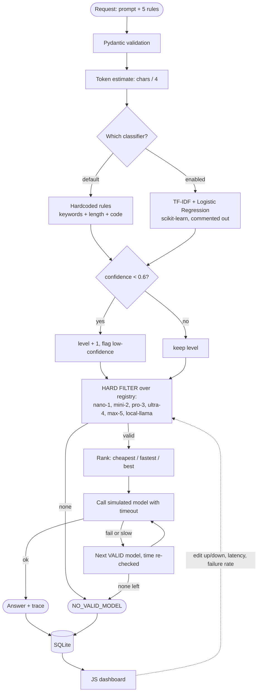

# Models, tech stack and implementation (hand-off sheet for another AI agent)

## 1. The 6 models in the demo registry (`src/models/registry.json`)
nano-1, mini-2, pro-3, ultra-4, max-5, local-llama. All simulated.

## 2. Six EXTRA fake models (not loaded; paste into `registry.json` to add)
| Name | Idea | Capability | Context | ₹ per 1k | Latency |
|---|---|---|---|---|---|
| `flash-2` | Very fast chat model | 2 | 32,000 | 0.04 | 250 ms |
| `code-3` | Code specialist | 3 | 48,000 | 0.35 | 1,400 ms |
| `long-3` | Long-document reader | 3 | 400,000 | 0.60 | 3,500 ms |
| `legal-4` | Contract and law specialist | 4 | 150,000 | 1.40 | 3,800 ms |
| `edge-1` | Tiny on-device model, free | 1 | 2,000 | 0.00 | 150 ms |
| `elite-5` | Top reasoning model | 5 | 256,000 | 3.50 | 7,000 ms |
```json
[{"name":"flash-2","capability":2,"context_limit":32000,"cost_per_1k":0.04,"latency_ms":250,"failure_rate":0.0,"status":"up"},
 {"name":"code-3","capability":3,"context_limit":48000,"cost_per_1k":0.35,"latency_ms":1400,"failure_rate":0.0,"status":"up"},
 {"name":"long-3","capability":3,"context_limit":400000,"cost_per_1k":0.60,"latency_ms":3500,"failure_rate":0.0,"status":"up"},
 {"name":"legal-4","capability":4,"context_limit":150000,"cost_per_1k":1.40,"latency_ms":3800,"failure_rate":0.0,"status":"up"},
 {"name":"edge-1","capability":1,"context_limit":2000,"cost_per_1k":0.0,"latency_ms":150,"failure_rate":0.0,"status":"up"},
 {"name":"elite-5","capability":5,"context_limit":256000,"cost_per_1k":3.5,"latency_ms":7000,"failure_rate":0.0,"status":"up"}]
```

## 3. Tech stack
| Layer | Tool | File |
|---|---|---|
| API | FastAPI + Pydantic v2 + Uvicorn | `src/gateway/main.py`, `schemas.py` |
| Pipeline | Plain Python (asyncio) | `router.py`, `filter.py`, `ranking.py`, `failover.py` |
| "AI" classifier (active) | Hardcoded keyword + length rules | `src/classifier/predict.py` |
| AI classifier (optional, commented) | scikit-learn TF-IDF + Logistic Regression, joblib | `predict.py`, `train.py`, `prompts.csv` |
| Models | Simulated async functions (seeded failures) | `src/models/simulated.py` |
| Real local model (optional, commented) | Ollama + httpx | `simulated.py` bottom |
| Storage | SQLite | `src/gateway/logger.py` |
| Frontend | Vanilla JavaScript, HTML, CSS (no build step) | `src/dashboard/` |
| Tests | pytest | `tests/` |

## 4. Flowchart (with every model used)


## 5. Implementation order and where each checkpoint lives
CP0 `registry.json` | CP1 `schemas.py` | CP2 `tokens.py` | CP4 `filter.py` | CP5 `ranking.py` | CP6/CP7 `failover.py` + `simulated.py` | CP8 refusal in `router.py` | CP3 `predict.py` | CP9 `logger.py` | CP10 `dashboard/` | CP11 `tests/`.

## 6. Setup
```bash
python -m venv .venv && source .venv/bin/activate     # Windows: .venv\Scripts\activate
pip install -r requirements.txt
uvicorn src.gateway.main:app --reload                  # open http://127.0.0.1:8000
pytest
```

## 7. Turn on the AI classifier (3 steps)
1. `pip install scikit-learn joblib` (and uncomment them in `requirements.txt`).
2. `python src/classifier/train.py` creates `src/classifier/model.joblib`.
3. In `src/classifier/predict.py` uncomment the `ml_classify` block and the 4 lines marked `STEP 3`. Restart the server.
